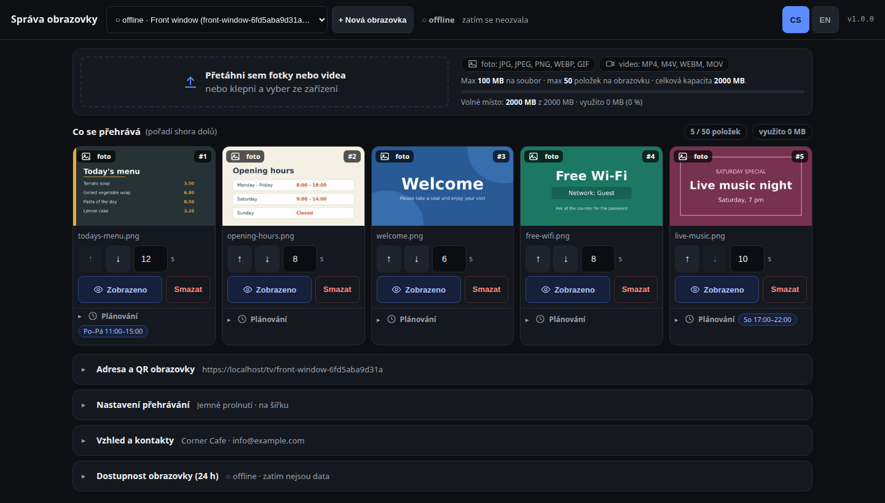
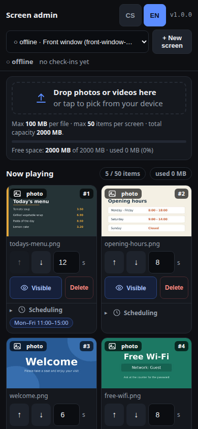
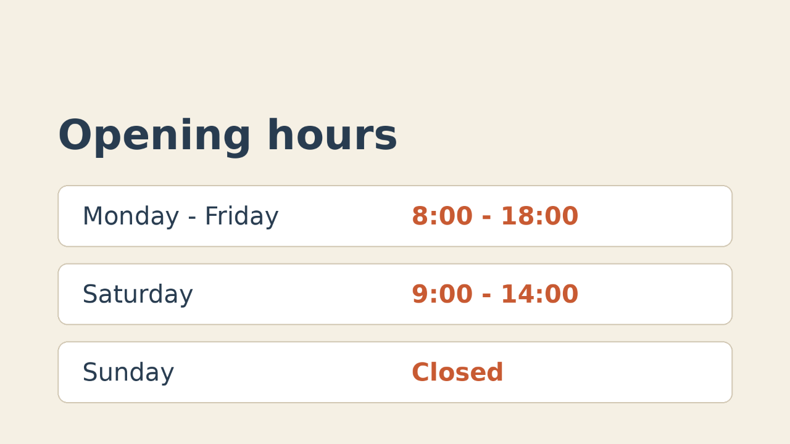

# Plain Signage

[English](README.md)

[](https://github.com/PeterkoCZ91/plain-signage/actions/workflows/ci.yml?query=branch%3Amain)

Digitální signage pro TV a panely, které si provozuješ sám. Malý server bez cloudového účtu a bez databáze přehrává fotky a videa ve smyčce na libovolném počtu obrazovek. Obrazovkou je levný Android box nebo jakýkoli prohlížeč otevřený na jednom URL; obsah se spravuje ve webovém adminu, česky nebo anglicky.



 

## Pro koho je

Pro malé provozovny s televizí na zdi a jedním člověkem, který ji aktualizuje: menu v kavárně, výloha, čekárna, recepce. Cílem je, aby majitel nahrál fotku z telefonu a za minutu ji viděl na obrazovce.

Záměrně nechce být platforma. Je jedno admin přihlášení, žádné role uživatelů, žádná vzdálená správa obrazovek nad rámec níže uvedeného, žádné šablony ani widgety a žádný spravovaný hosting. Pokud je potřebuješ, hodí se spíš komerční produkt.

## Co umí

- Přehrává obrázky (`.jpg .png .webp .gif`) a videa bez zvuku (`.mp4 .m4v .webm .mov`) ve smyčce, s délkou zobrazení pro každou položku.
- Plánuje každou položku podle dne v týdnu a časového rozsahu, takže polední menu se ukazuje jen v poledne.
- Z jednoho serveru obsluhuje libovolný počet obrazovek, každá má vlastní playlist, název, kontakt a vzhled.
- Spáruje novou obrazovku podle šestiznakového kódu a QR kódu na TV; v adminu ji převezmeš z telefonu. QR kódy na obrazovce mohou vést na tvůj web, Instagram nebo e-mail.
- Obsahuje Android kiosk aplikaci, která startuje po restartu, restartuje se při zaseknutí, aktualizuje se ze serveru a hlásí RAM, signál Wi-Fi a pády; VPN není potřeba; volitelný vzdálený přístup je popsán v [docs/cs/kiosk.md](docs/cs/kiosk.md#vzdálený-přístup-volitelný).
- Hraje dál při výpadku sítě: přehrávač drží playlist a média v cache service workeru.
- Volitelná upozornění přes Telegram na obrazovky, které jsou offline nebo ukazují prázdný obraz, viz [Řešení potíží](docs/cs/troubleshooting.md). Skripty pro zálohu, obnovu a nasazení jsou v `deploy/`.

## Rychlý start

Potřebuješ Docker s pluginem Compose.

```bash
git clone https://github.com/PeterkoCZ91/plain-signage signage && cd signage
cp .env.example .env            # nastav SIGNAGE_ADMIN_USER a SIGNAGE_ADMIN_PASS
docker compose up -d --build
```

Server ve výchozím stavu poslouchá na portu 8080; je-li obsazený, nastav v `.env` `SIGNAGE_PORT=<port>` a níže použij ten port. Pokud se kontejner nespustí, zkontroluj `docker compose logs`; server odmítne nezměněné heslo z `.env.example`.

1. Otevři `http://localhost:8080/admin` a přihlas se.
2. Obrazovka je jeden playlist s vlastní adresou, jedna na každou TV. Přidej ji přes **+ Nová obrazovka** a zadej popisek; dostane název např. `lobby-1a2b3c4d5e6f`.
3. Nahraj do obrazovky pár obrázků nebo videí.
4. Otevři `http://localhost:8080/tv/<screen>`, kde `<screen>` je název obrazovky z adminu, v prohlížeči na TV nebo na počítači.
5. Chceš-li místo prohlížeče Android box, sestav kiosk aplikaci a spáruj ji. Hotové APK není a aplikace funguje jen proti HTTPS serveru s certifikátem, kterému Android věří (prosté `http://localhost:8080` nestačí), proto nejdřív dej server za HTTPS ([instalace](docs/cs/install.md#produkční-nasazení)). Pak postupuj podle části [Než začneš](docs/cs/kiosk.md#než-začneš): APK sestavíš s JDK 17 a Android SDK, nainstaluješ přes ADB a box ukáže kód a QR; naskenuj ho a v adminu klikni na **Připojit TV** ([párování](docs/cs/kiosk.md#první-spuštění-a-párování), [Rychlá kontrola](docs/cs/kiosk.md#rychlá-kontrola)).

## Co je ověřené a co ne

Ověřeno: testy serveru, end-to-end testy v prohlížeči, přehrávač na Xiaomi Mi TV Stick, start kiosku po `adb reboot` a jeho hlášení na server a kolečko záloha a obnova v testu.

Neověřeno: studený start boxu po odpojení napájení (včetně HDMI-CEC), vypnutí a zapnutí TV, watchdog při skutečném výpadku sítě, `backup.sh` a `restore.sh` na běžící službě a přehrávače v prohlížečích chytrých TV (Tizen, webOS, Google TV). První načtení obrazovky potřebuje internet; offline přehrávání funguje až po úplném stažení playlistu. Kód neprošel nezávislým bezpečnostním posudkem.

## Dokumentace

[Instalace](docs/cs/install.md) · [Architektura](docs/cs/architecture.md) · [HTTP API](docs/cs/api.md) · [Kiosk](docs/cs/kiosk.md) · [Řešení potíží](docs/cs/troubleshooting.md) · [English docs](docs/en/install.md)

## Testy

Vše spouštěj z kořene repozitáře, každý příkaz zvlášť:

```bash
(cd deploy/app && python3 -m pytest -q)        # testy serveru; potřebují pytest, segno, ffmpeg (náhledy)
node --test deploy/app/tv/test/*.test.mjs      # skripty přehrávače a adminu; Node 20 a novější
(cd deploy/app && ruff check .)                # lint (pip install ruff)
shellcheck -S warning deploy/*.sh deploy/tools/*.sh kiosk-app/build.sh wifi-app/build.sh
bash deploy/test-backup-restore.sh             # kolečko záloha a obnova
```

- Aplikace kiosku: obyčejné Java testy bez Androidu, příkazy v [docs/cs/kiosk.md](docs/cs/kiosk.md#build) (`AllowlistTest`, `WatchdogTest`, `UpdatePolicyTest`, `HealthTest`, `LoadErrorTest`, `DiagTest`).
- E2E v pravém prohlížeči (`pip install playwright segno`, `playwright install chromium`, `ffmpeg` pro test videa): `(cd deploy/app && python3 -m pytest e2e -q)`; bez `playwright` se přeskočí. Viz [deploy/app/e2e/README.md](deploy/app/e2e/README.md).
- Na Pythonu 3.13 a novějším se 4 testy shody parseru multipart přeskočí, protože modul `cgi` už neexistuje; je to v pořádku.

## Licence

Dotazy a nápady: [Discussions](https://github.com/PeterkoCZ91/plain-signage/discussions). Chyby: [nový issue](https://github.com/PeterkoCZ91/plain-signage/issues/new/choose). MIT, viz [LICENSE](LICENSE). Přispívání: [CONTRIBUTING.md](CONTRIBUTING.md). Pravidla chování: [CODE_OF_CONDUCT.md](CODE_OF_CONDUCT.md). Hlášení bezpečnostních chyb: [SECURITY.md](SECURITY.md). Licence použitých knihoven: [THIRD_PARTY_LICENSES.md](THIRD_PARTY_LICENSES.md). Změny: [CHANGELOG.md](CHANGELOG.md).
