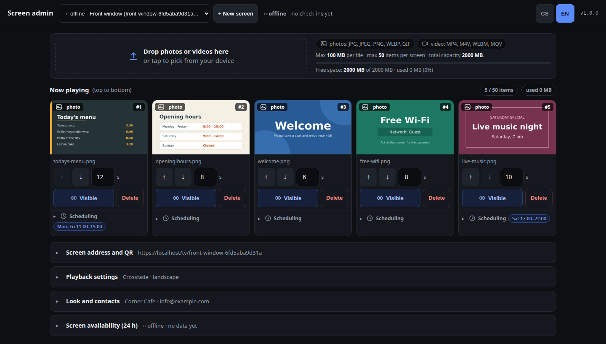
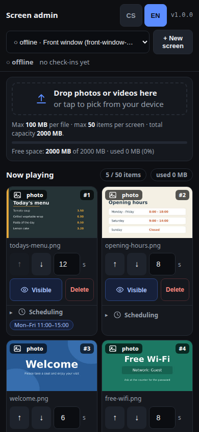
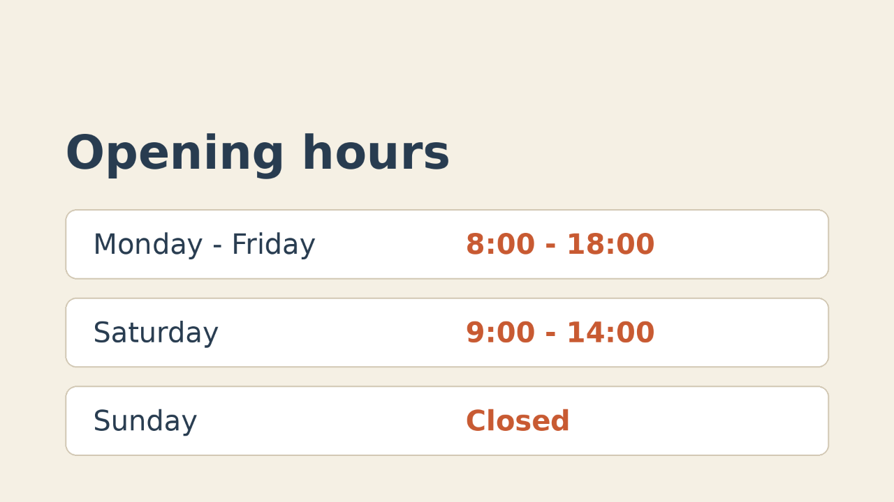

# Plain Signage

[Česky](README.cs.md)

[](https://github.com/PeterkoCZ91/plain-signage/actions/workflows/ci.yml?query=branch%3Amain)

Self-hosted digital signage for TVs and panels. A small server you run yourself, with no cloud account and no database, plays photos and videos in a loop on any number of screens. A screen is a cheap Android box or any browser opened on one URL; content is managed in a web admin in Czech or English.



 

## Who it is for

Small venues with a TV on the wall and one person who updates it: a cafe menu, a shop window, a waiting room, a reception desk. The aim is that the owner can upload a photo from a phone and see it on the screen a minute later.

It deliberately does not try to be a platform. There is one admin login, no user roles, no remote screen management beyond what is listed below, no templates or widgets, and no managed hosting. If you need those, a commercial signage product fits better.

## What it does

- Plays images (`.jpg .png .webp .gif`) and muted videos (`.mp4 .m4v .webm .mov`) in a loop, with a per-item duration.
- Schedules each item by weekday and time range, so a lunch menu shows only at lunch.
- Serves any number of screens from one server, each with its own playlist, name, contact and branding.
- Pairs a new screen by a six-character code and QR code shown on the TV; you claim it in the admin from your phone. QR codes on the screen can also point to your web, Instagram or e-mail.
- Includes an Android kiosk app that starts after a reboot, restarts when it hangs, updates itself from your server and reports RAM, Wi-Fi signal and crashes; a VPN is not required; optional remote access is described in [docs/en/kiosk.md](docs/en/kiosk.md#remote-access-optional).
- Keeps playing when the network drops: the player caches the playlist and media in a service worker.
- Optional Telegram alerts for screens that go offline or show a blank picture, see [Troubleshooting](docs/en/troubleshooting.md). Backup, restore and deploy scripts are in `deploy/`.

## Quick start

You need Docker with the Compose plugin.

```bash
git clone https://github.com/PeterkoCZ91/plain-signage signage && cd signage
cp .env.example .env            # set SIGNAGE_ADMIN_USER and SIGNAGE_ADMIN_PASS
docker compose up -d --build
```

The server listens on port 8080 by default; set `SIGNAGE_PORT=<port>` in `.env` if it is taken, and use that port below. If the container does not start, check `docker compose logs`; the server refuses the unchanged password from `.env.example`.

1. Open `http://localhost:8080/admin` and log in.
2. A screen is one playlist with its own address, one per TV. Add it with **+ New screen** and give it a label; it gets a name such as `lobby-1a2b3c4d5e6f`.
3. Upload a few images or videos to the screen.
4. Open `http://localhost:8080/tv/<screen>`, with the screen's name from the admin, in a browser on the TV or any computer.
5. To use an Android box instead of a browser, build the kiosk app and pair it. There is no prebuilt APK, and the app works only against an HTTPS server with a certificate Android trusts (plain `http://localhost:8080` is not enough), so put the server behind HTTPS first ([installation](docs/en/install.md#production-deployment)). Then follow [Before you start](docs/en/kiosk.md#before-you-start): you build the APK with JDK 17 and the Android SDK, install it over ADB, and the box shows a code and QR; scan it and click **Connect TV** in the admin ([pairing](docs/en/kiosk.md#first-run-and-pairing), [Quick check](docs/en/kiosk.md#quick-check)).

## What is verified and what is not

Verified: the server test suite, browser end-to-end tests, the player on the Xiaomi Mi TV Stick, the kiosk starting after `adb reboot` and reporting to the server, and a backup and restore round trip in a test.

Not verified: a cold start of a box after unplugging power (including HDMI-CEC), a TV power cycle, the watchdog during a real network outage, `backup.sh` and `restore.sh` on a live service, and players in smart TV browsers (Tizen, webOS, Google TV). The first load of a screen needs internet; offline playback works only after the playlist has been downloaded completely. The code has not had an independent security review.

## Documentation

[Installation](docs/en/install.md) · [Architecture](docs/en/architecture.md) · [HTTP API](docs/en/api.md) · [Kiosk app](docs/en/kiosk.md) · [Troubleshooting](docs/en/troubleshooting.md) · [Czech docs](docs/cs/install.md)

## Tests

Run everything from the repository root, each command on its own:

```bash
(cd deploy/app && python3 -m pytest -q)        # server tests; needs pytest, segno, ffmpeg (thumbnails)
node --test deploy/app/tv/test/*.test.mjs      # player and admin scripts; Node 20 or newer
(cd deploy/app && ruff check .)                # lint (pip install ruff)
shellcheck -S warning deploy/*.sh deploy/tools/*.sh kiosk-app/build.sh wifi-app/build.sh
bash deploy/test-backup-restore.sh             # backup and restore round trip
```

- Kiosk app: plain Java tests without Android, commands in [docs/en/kiosk.md](docs/en/kiosk.md#build) (`AllowlistTest`, `WatchdogTest`, `UpdatePolicyTest`, `HealthTest`, `LoadErrorTest`, `DiagTest`).
- E2E in a real browser (`pip install playwright segno`, `playwright install chromium`, `ffmpeg` for the video test): `(cd deploy/app && python3 -m pytest e2e -q)`; without `playwright` they are skipped. See [deploy/app/e2e/README.md](deploy/app/e2e/README.md).
- On Python 3.13 and newer the 4 multipart parity tests are skipped because the `cgi` module is gone; this is expected.

## License

Questions and ideas: [Discussions](https://github.com/PeterkoCZ91/plain-signage/discussions). Bugs: [open an issue](https://github.com/PeterkoCZ91/plain-signage/issues/new/choose). MIT, see [LICENSE](LICENSE). Contributing: [CONTRIBUTING.md](CONTRIBUTING.md). Code of conduct: [CODE_OF_CONDUCT.md](CODE_OF_CONDUCT.md). Security reports: [SECURITY.md](SECURITY.md). Third-party licenses: [THIRD_PARTY_LICENSES.md](THIRD_PARTY_LICENSES.md). Changes: [CHANGELOG.md](CHANGELOG.md).
